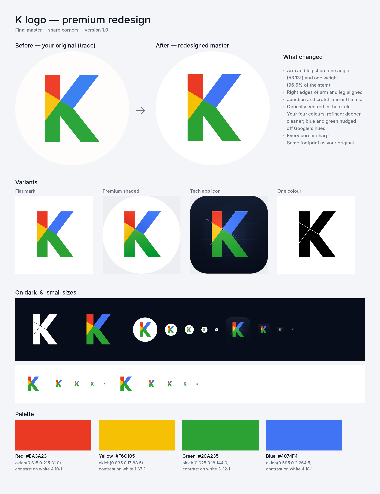

# K Logo — brand kit

The client's four-colour "K", traced exactly from the original and redesigned in premium
quality. Every file here is generated from one master (`tools/brand.py`), so a change to the
geometry or a colour is one edit plus one re-run.



## What changed in the redesign

| | Original | Redesign |
| --- | --- | --- |
| Arm / leg angle | 52.75° / 51.66° (unequal) | one 4:3 slope, 53.13°, for both |
| Stroke weights | arm 98.4 %, leg 96.7 % of the stem | arm = leg = 96.5 % (optical compensation for diagonals) |
| Right edges | arm and leg off by 5 units | aligned exactly |
| Junction / crotch | arbitrary | mirror each other about the fold point P |
| Centring | bounding box | optical (+14 / −6 units on the 1024 grid) |
| Corners | sharp | sharp, everywhere (client's choice) |
| Colours | close to Google's palette | the client's own hues, deepened and moved away from Google's |
| Footprint | cap height 58.7 % of the disc | unchanged |

The trace (`source/K-Logo_trace.svg`) matches the original JPEG on 99.8 % of pixels; every
mismatch is a 1-pixel anti-aliased edge.

## Which file do I use?

| Need | Use |
| --- | --- |
| Edit in **Adobe Illustrator** | `logo/ai/*.ai` — PDF-compatible Illustrator files, exact vector paths. Illustrator opens them as one layer with grouped shapes. |
| Edit in **Adobe Photoshop** | `logo/psd/*.psd` — 4096 px, 300 dpi, sRGB. Flat facets are **editable vector shape layers**; gradient lighting sits on separate pixel layers. `K-Logo_All-Variants.psd` holds every main variant as a toggleable layer group. |
| **Print** (offset, signage, merch) | `logo/ai/*_CMYK.ai`, `logo/pdf/*_CMYK.pdf`, `logo/eps/*_CMYK.eps` — device CMYK. |
| Other vector apps (Figma, Affinity, Inkscape, CorelDRAW) | `logo/svg/*.svg` (layered, named groups) or `logo/eps/*.eps` |
| Websites, documents, slides | `logo/png/*` (256–4096 px, transparent) or `web/svg/*` |
| Favicon / PWA | `icons/web/` + paste `icons/web/head-snippet.html` into `<head>` |
| iOS / macOS / Android apps | `icons/ios/AppIcon.appiconset/`, `icons/macos/`, `icons/android/res/` |
| Profile pictures, link previews, banners | `social/` |
| Code (React, Web Component, design tokens) | `web/` — see `web/README.md` |

### Variants

| Variant | File stem | When |
| --- | --- | --- |
| Primary mark | `K-Logo_Mark_Color` (`_Tight`, `_ClearSpace`) | default, on white or light backgrounds |
| Avatar badge | `K-Logo_Badge_Color` | profile pictures, round crops, photos |
| Premium shaded | `K-Logo_Mark_Dimensional`, `K-Logo_Badge_Dimensional` | hero use, splash screens, presentations (light backgrounds) |
| Tech app icon | `K-Logo_Tech_Icon` (`_Small` ≤ 64 px, `_Square` app stores, `_macOS`) | app icons, dark product UI |
| One colour, gapped | `K-Logo_Mark_Black`, `K-Logo_Mark_White` | one-colour print, engraving, reversed on dark (≥ 32 px) |
| One colour, solid | `K-Logo_Mark_Black_Solid`, `K-Logo_Mark_White_Solid` | very small sizes, stamps, embroidery |
| Greyscale | `K-Logo_Mark_Greyscale` | black-only print where tints are possible |

## Colour

| | HEX | RGB | OKLCH | CMYK (approx.) | on white | on night |
| --- | --- | --- | --- | --- | --- | --- |
| Red | `#EA3A23` | 234 58 35 | 0.615 0.215 31.0 | 2 93 99 0 | 4.10:1 | 4.74:1 |
| Yellow | `#F6C105` | 246 193 5 | 0.835 0.170 88.5 | 4 24 100 0 | 1.67:1 | 11.60:1 |
| Green | `#2CA235` | 44 162 53 | 0.625 0.180 144.0 | 80 10 100 1 | 3.32:1 | 5.85:1 |
| Blue | `#4074F4` | 64 116 244 | 0.595 0.200 264.5 | 75 58 0 0 | 4.18:1 | 4.64:1 |
| Ink | `#141A29` | 20 26 41 | — | 84 77 55 70 | 17.36:1 | — |
| Night | `#070D1A` | 7 13 26 | — | 80 73 59 79 | 19.42:1 | — |

CMYK values come from an ICC conversion (sRGB → Ghostscript's *Artifex CMYK SWOP Profile*,
relative colorimetric with black-point compensation). The blue is outside the CMYK gamut
(ΔE76 ≈ 32); for print jobs where the blue matters, have the printer match `#4074F4` with a spot
ink chosen against a physical swatch book. Use your printer's own profile for press work.

## Rules

- Every corner of the K is **sharp**. Only containers (the disc, the app tile) are curved.
- Never recolour, rearrange, rotate, stretch, outline or add effects to the flat mark.
- Brand yellow never stands alone on white (1.67:1) — it only appears inside the mark.
- Clear space: one stem width on every side (0.232 × the mark height).
- Minimum size: 16 px (the favicons are pixel-hinted), 8 mm mark height in print; below 32 px use
  the solid one-colour mark instead of the gapped one.
- No name or wordmark is defined yet, so none is drawn anywhere in the kit.

## Rebuild

```bash
pip install pillow numpy shapely psd-tools          # plus librsvg (rsvg-convert) and Ghostscript
python3 brand/tools/build.py svg formats            # master SVGs, AI/PDF/EPS (RGB + CMYK), PSD
python3 brand/tools/build_raster.py                 # PNGs, icons, social images (+ verification)
python3 brand/tools/build_web.py                    # developer kit
```

| Tool | Job |
| --- | --- |
| `tools/kmark.py` | Parametric construction of the K (stem, arm, leg, junction J, fold point P, crotch C) |
| `tools/brand.py` | Final master: geometry, palette, every variant as layered SVG, supersampled rendering |
| `tools/svg2psd.py` | SVG → layered PSD with editable vector shape layers |
| `tools/vector_export.py` | SVG → PDF / AI / EPS (RGB, vector gradients) and device-CMYK print files |
| `tools/build_raster.py`, `tools/build_web.py` | PNG / icon / social and developer-kit stages |
| `tools/trace_svg.py`, `tools/trace_params.json` | The exact trace of the original |
