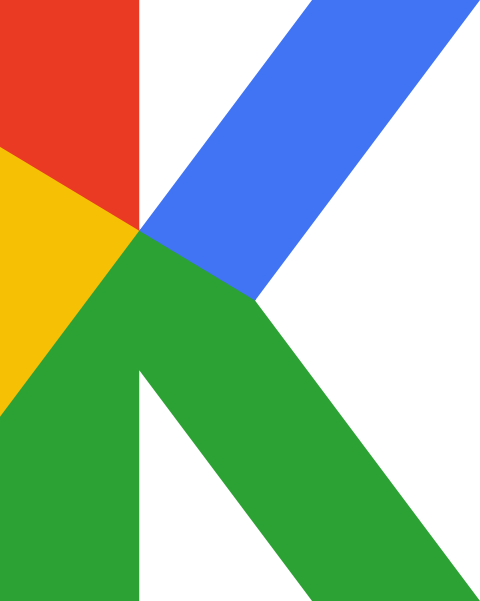

# K logo - developer kit

Generated by brand/tools/build_web.py from brand/tools/brand.py - do not edit by hand. Re-run `python3 brand/tools/build_web.py` after any change to the master.

| Folder | What |
| --- | --- |
| `svg/` | Production SVGs: minimal markup, tight viewBox, `role="img"` + `<title>` |
| `react/` | `KLogo` React component (React 18+, no other dependency) |
| `web-component/` | `<k-logo>` custom element (no framework) |
| `tokens/` | Colours and geometry: DTCG JSON, CSS, SCSS, Tailwind, Android, iOS, Flutter |

## Brand rules (built into the files)

- Every corner of the K is sharp; only containers (disc, app tile) are curved. Never recolour,
  rotate, stretch, outline or rearrange the facets.
- Brand yellow (#F6C105) never stands alone on white (1.67:1); it only
  appears inside the mark.
- Clear space: 1 stem width on every side = `0.2321` x the mark height.
- Minimum height: 16 px for the colour mark, badge and `mono-solid`;
  32 px for the gapped `mono` / `white`.
- At 64 px and below use the simplified tech icon (`k-logo-tech-small.svg`); both components switch automatically.
- No name or wordmark is defined yet: do not set text next to or inside the mark as if it were one.
  The files carry the neutral title "K Logo"; replace it with the product name when there is one.

## SVG

| File | Use | Matches master | Master bytes / gzip | Web bytes / gzip | Max edge shift |
| --- | --- | --- | --- | --- | --- |
| `svg/k-logo.svg` | Primary mark, full colour | `K-Logo_Mark_Color.svg` | 791 / 387 | 412 / 273 | 0.026 |
| `svg/k-logo-mono.svg` | One colour (currentColor), construction gaps, >= 32 px | `K-Logo_Mark_Black.svg` | 903 / 454 | 363 / 273 | 0.026 |
| `svg/k-logo-mono-solid.svg` | One colour (currentColor), solid: < 32 px, stamps | `K-Logo_Mark_Black_Solid.svg` | 791 / 367 | 228 / 190 | 0.025 |
| `svg/k-logo-white.svg` | Reversed white, construction gaps, for dark grounds | `K-Logo_Mark_White.svg` | 903 / 454 | 355 / 268 | 0.026 |
| `svg/k-logo-badge.svg` | Avatar badge: the mark on the white disc | `K-Logo_Badge_Color.svg` | 912 / 436 | 512 / 305 | 0.029 |
| `svg/k-logo-dimensional.svg` | Premium shaded mark for light grounds | `K-Logo_Mark_Dimensional.svg` | 2,339 / 769 | 1,464 / 551 | 0.026 |
| `svg/k-logo-tech.svg` | Tech app icon, rounded tile, > 64 px | `K-Logo_Tech_Icon.svg` | 38,296 / 10,755 | 5,784 / 1,403 | 0.042 |
| `svg/k-logo-tech-small.svg` | Tech app icon simplified for <= 64 px | `K-Logo_Tech_Icon_Small.svg` | 1,761 / 686 | 1,023 / 475 | 0.029 |

Edge shift is the largest distance (in 1024-grid units) between an edge here and the same edge in
the brand document, measured by the build. `k-logo-mono*` paint with `currentColor`: inline them to
take the text colour (as an `` they render black), or use them as a CSS `mask-image` over a
`background-color`. The files have no width/height: always set a height.

```html

<span style="color: var(--k-logo-mono)"><!-- paste svg/k-logo-mono.svg inline --></span>
```

## React

Copy `react/` into the app (TypeScript or a TS-aware bundler; `.tsx` uses the `react-jsx` runtime).

```tsx
import { KLogo } from './react';

<KLogo />                                          // colour, 48 px high, decorative (aria-hidden)
<KLogo variant="dimensional" size={96} title="Home" />
<KLogo variant="tech" size={48} />                 // <= 64 px: simplified tech icon
<KLogo variant="mono" size="2.5rem" className="logo" style={{ color: 'var(--k-logo-mono)' }} />
```

Props: `variant` (color | mono | mono-solid | white | badge | dimensional | tech), `size` (height; number = px, string = CSS length;
width follows the aspect ratio), `title` (accessible name; without it the SVG is `aria-hidden`),
`className`, `style`. Gradient ids come from `useId`, so any number of logos can share a page.
The only hook is `useId`, so on React 19 it also renders as a Server Component.

## Web component

```html
<script type="module" src="web-component/k-logo.js"></script>
<k-logo variant="color" size="48" label="Home"></k-logo>
<k-logo variant="white" size="3rem" style="color: white"></k-logo>
```

Attributes: `variant`, `size` (number = px, else a CSS length), `label` (accessible name; without it
the logo is decorative). Shadow DOM; ids are unique per element; attributes can change at runtime.

## Tokens

```css
@import "tokens/tokens.css";      /* --k-red ... --k-night, hex with an OKLCH upgrade */
.hero { background: var(--k-surface); color: var(--k-text); }   /* light + dark aliases */
.logo { height: 48px; padding: calc(48px * var(--k-clear-space)); }
```

- `tokens.json` - W3C Design Tokens (DTCG 2025.10): `brand.color.*` (OKLCH with hex fallback),
  `neutral.*`, `semantic.light|dark.*` (aliases), `geometry.*`.
- `tokens.css` - custom properties; `@supports (color: oklch(0 0 0))` swaps in the brand's OKLCH
  definitions (the hex values are their 8-bit rounding, so a browser may paint them up to 1/255 apart);
  `prefers-color-scheme: dark` switches the semantic aliases (pin with `data-theme="light|dark"` on `<html>`).
- `tokens.scss` - `@use "tokens/tokens" as k;` then `k.$k-red`; with `@use "sass:map";`,
  `map.get(k.$k-colors, "blue")`.
- `tailwind.preset.js` - v3: `presets: [require('./tokens/tailwind.preset.js')]`; v4: `@config "./tokens/tailwind.preset.js";`.
  Classes `bg-k-red`, `text-k-ink`, `bg-k-night` ...
- `android/colors.xml` - copy to `res/values/`; `@color/k_red`, `R.color.k_blue`.
- `ios/BrandColors.swift` - add to the target; `Color.kRed`, `.foregroundStyle(.kBlue)`, `UIColor.kInk`.
- `flutter/brand_colors.dart` - `import 'brand_colors.dart';` then `BrandColors.red`.
